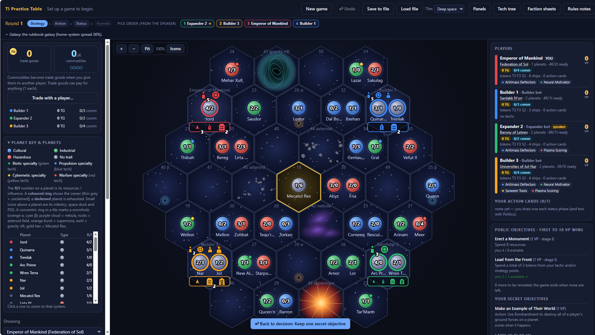

# Twilight Imperium Bot (Unofficial Fan Project)

An offline, single-player browser game inspired by *Twilight Imperium: Fourth Edition*, where you play against computer-controlled opponents. No install, no account, no server. Download the file, open it in your browser, and play.

> **Unofficial fan project.** This project is not affiliated with, endorsed by, sponsored by, or approved by Fantasy Flight Games, Asmodee, or any of their affiliates. See the [Disclaimer](#disclaimer) below.

## Play it

**Online:** [Play in your browser](https://gavinwirtz-sudo.github.io/Twilight-Imperium-4th-Ed-Single-Player-Html/)

**Offline:**
1. Click the green **Code** button on this page, then **Download ZIP**
2. Unzip the folder
3. Double-click `index.html` to open it in your browser (Chrome, Edge, Firefox, or Safari)

That's it. Everything runs locally in your browser.

## Screenshot

## Features

- Play a full game against computer-controlled opponents
- Runs entirely in your browser with no internet connection required after loading
- Save and resume your game in your browser

## How to play

This is a quick-start guide in my own words. The in-game **Rules notes** button explains how this version handles the details, and the **Tech tree** and **Faction sheets** buttons are always one click away.

### Setting up

1. Click **New game** and choose your faction and how many computer opponents you want to face.
2. The galaxy is built around the gold hex in the center, **Mecatol Rex**. Everyone starts in a home system near the edge of the map.
3. Take a look at your faction sheet, your starting planets, and the public objectives on the right side of the screen. Each player also holds secret objectives that only they can see.
4. The speaker (shown with a star in the order bar at the top) goes first. That role moves around the table as the game goes on.

### Your first round

Each round has four phases, shown at the top of the screen: **Strategy**, **Action**, **Status**, and **Agenda**.

- **Strategy:** In speaker order, each player claims a strategy card. The card you pick gives you a special ability for the round and decides when you act. Think about which one will help you most right now.
- **Action:** Players take turns doing one thing at a time until everyone passes. Your first few turns usually go to growing your economy and army: build ships and ground forces at your home, move fleets to nearby systems, and claim planets, because planets produce the resources and influence that pay for everything else. Research a technology early, because it makes your fleet stronger.
- **Status:** Check your objectives, score any you've met, draw new action cards, and get ready for the next round.
- **Agenda:** Once Mecatol Rex has been claimed, players vote on laws that change the rules for everyone.

### Early-game tips

- Grab the planets right next to your home first. They are cheap to reach and easy to defend.
- Don't spread your fleet too thin. A few strong stacks beat many lonely ships.
- Keep an eye on the public objectives and pick up the ones you can reach without too much risk.
- Trade goods and commodities are useful. Remember that giving commodities to another player turns them into trade goods you can spend.
- Use **Undo** if you misclick during your own turn, and **Save to file** before trying something risky.

### Winning

The first player to reach **10 victory points** wins. Points come from objectives, so the most reliable path to victory is steady expansion, smart alliances, and a strong fleet.

### Claim the throne

Every empire in the galaxy dreams of the same prize: the center hex, **Mecatol Rex**, the ancient seat of power. Grow your economy, build your fleet, and break through the enemy lines. Take the throne, rule the galaxy, and become the ruler of Mecatol Rex.

## Saving and privacy

Game progress is saved in your own browser's local storage on your own device. Nothing is sent to any server, and nothing is shared with anyone. Clearing your browser's site data will erase your saved game.

## Known limitations

- This is a fan-made approximation, not a complete or perfect implementation of the board game's rules
- The computer opponents are simple and will not play like experienced human players
- There are likely bugs I haven't found yet. If something looks wrong or breaks, please let me know. Any feedback is welcome and appreciated, see [Feedback and bugs](#feedback-and-bugs) below.

## Feedback and bugs

Found a bug or have an idea? Please send your feedback. Open an **Issue** using the Issues tab at the top of this repository and tell me what happened, what you expected, and which browser you were using. Comments on how the game plays, suggestions, and things you'd like to see added are all welcome too. This is a hobby project, so replies may take a while.

## Disclaimer

This is an unofficial, non-commercial fan project made for personal enjoyment and shared free of charge.

- *Twilight Imperium* and all related names, characters, artwork, and game content are the property of their respective owners, including Fantasy Flight Games and Asmodee. All trademarks and copyrights belong to them.
- This project is **not** affiliated with, endorsed by, or sponsored by Fantasy Flight Games, Asmodee, or any of their affiliates.
- This repository does not include scans, images, or text taken from official rulebooks, cards, or components. Any graphics are original or plain shapes and text.
- This software is provided "as is," without warranty of any kind. Use it at your own risk.
- If you are a rights holder and would like something changed or removed, please open an Issue or contact the repository owner and it will be addressed promptly.

If you enjoy the game, please support the creators by buying the real thing from [Fantasy Flight Games](https://www.fantasyflightgames.com/).

## License

The original code in this repository is released under the [MIT License](LICENSE). This license covers only the original code and does not grant any rights to *Twilight Imperium* trademarks, names, or content.

---

*Made by TI4 Enjoyer.*
